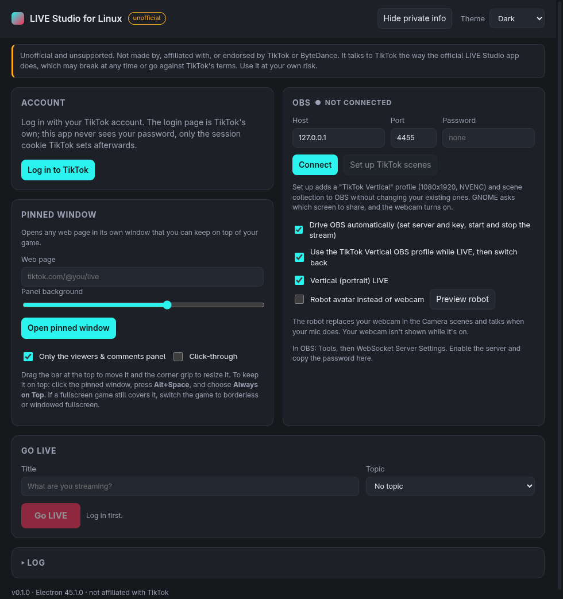
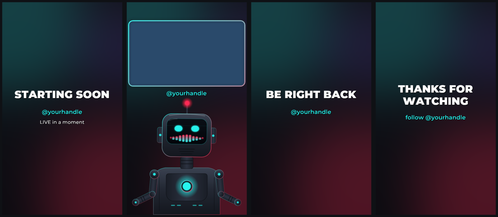
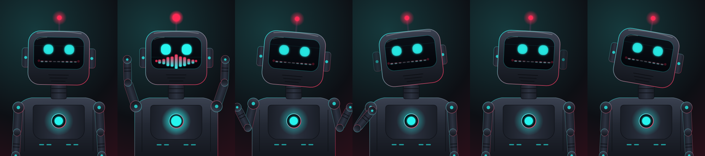
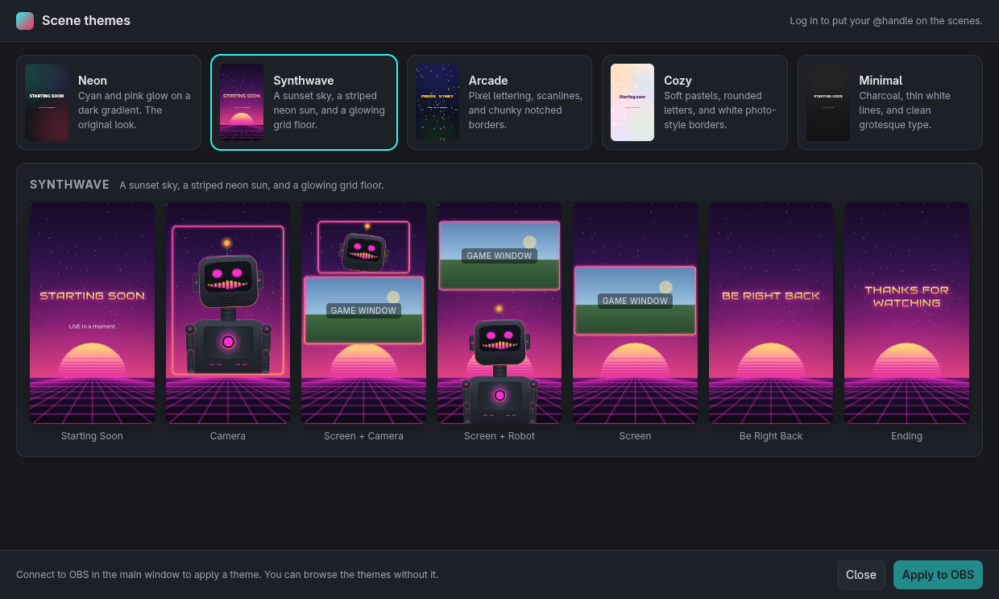

# LIVE Studio for Linux (unofficial)

**Go LIVE on TikTok from Linux with OBS Studio, without a stream key.** LIVE Studio for Linux is an unofficial, open-source alternative to TikTok LIVE Studio, which TikTok makes for Windows and macOS only. It handles the TikTok side (logging in, creating the LIVE, getting the stream URL, and ending the LIVE) and drives OBS for capture and encoding. It ships as an AppImage for x86_64 Linux.



> **Unofficial and unsupported.** This project is not made by, affiliated with, or endorsed by TikTok or ByteDance. TikTok publishes LIVE Studio for Windows and macOS only. This app talks to TikTok's servers the same way the official LIVE Studio app does, using your own login. TikTok can change or block that at any time, and using a client TikTok didn't make might go against [TikTok's Terms of Service](https://www.tiktok.com/legal/page/us/terms-of-service/en). Your account is your responsibility. There is no warranty and no support. If you need something reliable, use TikTok's official tools.

## Status

Version 0.1.0 has gone LIVE end to end with a real account: log in, create the room, stream from OBS, keep the heartbeat, and end the LIVE, on Fedora 44 with OBS 32.1 and a US account. The request formats come from reading the JavaScript inside the official LIVE Studio 1.38.0 for macOS. Expect rough edges, and check the **Log** panel when something fails.

## What it does

- Opens TikTok's own login page in a window, so you sign in on TikTok and the app keeps only the session cookie TikTok sets.
- Shows whether your account has LIVE Studio access, and opens TikTok's own application page if it doesn't.
- Sends requests to your account's regional servers, including US accounts on `*.tiktokv.us`.
- Creates a LIVE room with your title and topic, and gets the RTMP server and stream key for that room.
- Drives OBS through its built-in WebSocket server: switches to the TikTok profile, sets the server and key, starts the stream, and puts your previous OBS settings back afterwards.
- Sends the heartbeat TikTok expects every 5 seconds while you're LIVE, and ends the room cleanly when you click **End LIVE**, stop streaming in OBS, or quit the app.
- Builds a styled vertical TikTok profile and scene collection in OBS with one click.
- Can replace your webcam with a voice-reactive robot avatar.
- Opens a pinned window that keeps a web page, such as your LIVE page's viewers and comments panel, on top of your game.
- Hides your account, OBS address, and stream details with one click, for when you share your whole screen.

OBS does all of the capture, scenes, and encoding. This app handles the TikTok side.





## Requirements

- Linux x86_64. Developed on Fedora 44 with GNOME on Wayland.
- [OBS Studio](https://obsproject.com/) 28 or later. Version 28 and later include obs-websocket 5.
- A TikTok account with **LIVE Studio access**. That's a separate grant from going LIVE in the phone app: an account can go LIVE from the phone and still get `you have no live auth` here. The **Account** panel shows your status and TikTok's requirements, and **Apply for LIVE Studio access** opens TikTok's application page. This app doesn't get around any of TikTok's requirements.
- Node.js 20 or later and npm, to build from source.

## Install

When a release is published, download `live-studio-linux-<version>-x86_64.AppImage` and `SHA256SUMS` from the [releases page](https://github.com/averagenative/tiktok-live-studio-linux/releases), then:

```sh
sha256sum -c SHA256SUMS
chmod +x live-studio-linux-*-x86_64.AppImage
./live-studio-linux-*-x86_64.AppImage
```

### Build from source

1. Clone the repository and install the dependencies:

   ```sh
   git clone https://github.com/averagenative/tiktok-live-studio-linux.git
   cd tiktok-live-studio-linux
   npm install
   ```

2. Run the checks, then start the app:

   ```sh
   make check
   make run
   ```

3. To build an AppImage and add it to your application menu:

   ```sh
   make appimage
   make install
   ```

   `make install` copies the AppImage to `~/Applications` and registers a `.desktop` entry and an icon.

## Set up OBS

1. In OBS, open **Tools > WebSocket Server Settings**.
2. Select **Enable WebSocket server**.
3. Click **Show Connect Info** and copy the server password.
4. In this app's **OBS** panel, paste the password and click **Connect**.

The default host and port (`127.0.0.1`, `4455`) match OBS's defaults. The LAN address that **Show Connect Info** offers works too.

### Set up TikTok scenes

Click **Set up TikTok scenes** to open the **Scene themes** window. It shows every scene in each theme, with your @handle, a stand-in for your game, and your webcam or the robot avatar, so you can compare themes before you change anything in OBS:

| Theme | Look |
|---|---|
| **Neon** | Cyan and pink glow on a dark gradient |
| **Synthwave** | A sunset sky, a striped neon sun, and a glowing grid floor |
| **Arcade** | Pixel lettering, scanlines, and notched borders, with **PRESS START** and **GAME OVER** titles |
| **Cozy** | Soft pastels, rounded letters, and white photo-style borders |
| **Minimal** | Charcoal, thin white lines, and clean grotesque type |



Pick a theme and click **Apply to OBS**, with OBS connected. The app adds the following to OBS and leaves your other profiles and scene collections alone:

- A **TikTok Vertical** profile: 1080x1920 at 30 fps, NVENC H.264 at 6000 kbps, and AAC audio at 160 kbps.
- A **TikTok Vertical** scene collection with seven scenes: **Starting Soon**, **Camera**, **Screen + Camera**, **Screen + Robot**, **Screen**, **Be Right Back**, and **Ending**, in the theme you picked. **Screen + Robot** puts the game in a full-width window at the top and a large robot avatar below it. The robot takes on the theme's colors.
- `Mic` and `Desktop Audio` sources in every scene, with noise suppression, a compressor, and a limiter on the mic. `Mic` uses your system's default input, so pick your microphone in GNOME **Settings > Sound > Input**. If you set a USB mic as preferred there, OBS uses it whenever it's plugged in and falls back to the built-in mic otherwise.

During the setup, the webcam turns on and GNOME asks which window to share for the `Game Window` source. Pick your game. The result appears under the button, including anything that needs your attention.

To switch themes, apply another one. The scenes keep their sources and layout, and only the artwork and the robot's colors change. Applying again also fills in whatever is missing and leaves anything you added or moved alone.

The app draws each theme's background, frames, and text into images, with fonts it bundles, so OBS shows the theme the same way on any distribution without extra fonts. To change the words, add your own text source on top in OBS. If OBS runs on another machine, the app can't hand it images, so it sets up plain scenes with OBS text sources instead.

If the game capture didn't get added, add it yourself and apply the theme again to fit it into the frames:

1. In OBS, select **Screen + Camera**.
2. Click **+** under **Sources** and choose **Window Capture (PipeWire)**.
3. Name it `Game Window`. The name matters, and it can't be `Screen`, because OBS doesn't allow a source and a scene to share a name.
4. Click **Open Selector** and pick the game window.

To change any text, double-click the text source in OBS.

If you'd rather not let the app control OBS, clear **Drive OBS automatically**. When you go LIVE, the app shows the server and stream key. Paste them into OBS under **Settings > Stream > Service: Custom**, start streaming, and then click **I've started streaming in OBS**.

## Go LIVE

1. Click **Log in to TikTok** and sign in. The window closes after TikTok sets your session.
2. Check that the **Account** panel shows **LIVE access: ready** and **LIVE Studio access: granted**.
3. In OBS, pick a scene from the **TikTok Vertical** collection, or build your own on a 1080x1920 canvas. Select **Vertical (portrait) LIVE** for a portrait LIVE.
4. Enter a title, pick a topic if you want one, and click **Go LIVE** in this app's main window.
5. The badge changes from **PREPARING** to **LIVE** after OBS reports that the stream is running. With **Use the TikTok Vertical OBS profile while LIVE** selected, OBS switches to that profile for the LIVE.
6. To finish, click **End LIVE**. OBS stops streaming and switches back to your previous profile. Stopping the stream in OBS or quitting the app also ends the LIVE.

## Robot avatar

To stay off camera, select **Robot avatar instead of webcam** in the **OBS** panel. An animated robot replaces your webcam in the **Camera** and **Screen + Camera** scenes, and the **Screen + Robot** scene always shows it. It blinks, bobs, and lights up its equalizer mouth when your mic picks up your voice. When you get loud, it throws both arms up in a cheer. It also moves on its own: head tilts, turns, and nods while you talk, and shrugs or brushes off a shoulder in quieter moments. Your webcam is hidden from the stream while the robot is on. Clear the option to switch back.

- The robot is an OBS **Browser** source that loads `http://127.0.0.1:47812/avatar` from this app, so keep the app running while you're LIVE.
- The mouth follows the level of your mic input in OBS (`Mic`, or `Mic/Aux` in other scene collections), after the mic filters.
- Click **Preview robot** to see it react to your voice. The preview needs the OBS connection, because the level comes from OBS.
- It works only when OBS runs on the same machine as the app.

## Pinned window

The **Pinned window** panel opens a web page in a small window that you can keep on top of your game. Your LIVE page is filled in after you log in.

1. Click **Open pinned window**.
2. Drag the thin bar at the top of the window to move it, and drag the corner grip to resize it.
3. Click the pinned window, press **Alt+Space**, and choose **Always on Top**.

On TikTok LIVE pages, **Only the viewers & comments panel** hides the rest of the page and shows the side panel over the whole window on a see-through backing, so the game shows through behind the chat. **Panel background** sets how solid that backing is. Clear the option to see the full page. It only changes what the window displays.

Links that leave your LIVE page, like **Moderator** in the Viewers gear menu, open in a separate window, so the pinned chat stays where it is.

The pinned window is always muted. A LIVE page plays your own stream back a few seconds late, and without headphones OBS's **Desktop Audio** would capture it and loop it into your LIVE. The app remembers the address and size. GNOME decides where the window opens. If a fullscreen game still covers the window, switch the game to borderless or windowed fullscreen.

GNOME doesn't let native Wayland apps pin their own windows, which is why you pin it from GNOME's window menu. Starting the app with `LSL_X11=1` runs it through XWayland instead, where the pinned window keeps itself on top and offers click-through. On some hybrid Intel/NVIDIA laptops, that mode fails to open windows at all.

## Hide private info

If you share your whole screen, click **Hide private info** in the top bar before you go LIVE. While it's on, the main window:

- Hides your account name, username, and profile picture.
- Shows the OBS host and port, and the pinned window's web address, as dots.
- Hides the RTMP server, stream key, and room ID. **Copy** still copies them.
- Hides the log. **Copy log** still copies all of it.

The setting stays on until you click the button again, including after you restart the app. It covers this app's main window only. TikTok's own pages, like the login window, show what they always show, so log in before you start sharing your screen.

## Optional OBS extras

These plugins aren't required, but they work well with a TikTok setup on Fedora:

- **Game capture with less overhead**: `sudo dnf install obs-studio-plugin-vkcapture`, then add a **Game Capture (Vulkan/OpenGL)** source and start games with `obs-gamecapture %command%` (in Steam's launch options) or `obs-gamecapture <game>`.
- **Phone as a camera**: `sudo dnf install obs-studio-plugin-droidcam`, plus the DroidCam app on your phone.
- **Background removal for the webcam**: the [obs-backgroundremoval](https://github.com/royshil/obs-backgroundremoval) plugin.

## Troubleshooting

- **"you have no live auth" (status_code 20800).** The account doesn't have LIVE Studio access yet, even if it can go LIVE from the phone. Check the **Account** panel and use **Apply for LIVE Studio access**.
- **The Go LIVE button on TikTok's application page spins.** That page expects the official app. Close the window and use **Go LIVE** in this app's main window.
- **LIVE access shows an error.** That message comes from TikTok. It usually means the account doesn't meet TikTok's requirements or has a restriction. This app can't change that.
- **LIVE access shows HTTP 403.** Your session works only on your account's regional servers. The app picks them from your login cookies and logs the choice (`using webcast host ...`). If it picks the wrong one, quit the app and set `"webcastHost": "https://webcast16-normal-useast5.tiktokv.us"` (or another host from [docs/PROTOCOL.md](docs/PROTOCOL.md#regional-hosts)) in `~/.config/LIVE Studio for Linux/settings.json`.
- **"TikTok refused to create the LIVE".** The **Log** panel shows the `status_code` and `logid` from TikTok. Open an issue with those, and remove anything personal first.
- **OBS won't connect.** Make sure the WebSocket server is enabled in OBS and that the password matches.
- **The game capture is missing after the setup.** Add a `Game Window` source as described in [Set up TikTok scenes](#set-up-tiktok-scenes).
- **Your LIVE's audio echoes or loops.** Something is playing your LIVE back through your speakers, and OBS's **Desktop Audio** captures it. The pinned window is muted, but a browser tab with your LIVE open isn't: mute or close it. Without headphones, your mic also picks up game sound from the speakers; headphones avoid that.
- **OBS doesn't hear your USB mic.** Make it the default input in GNOME **Settings > Sound > Input**. The `Mic` source follows the default.
- **The LIVE ends by itself after a short time.** TikTok ends a room when the heartbeat stops. Check the log for `ping failed` lines, which point to a network problem.
- **Login loops or shows a captcha.** Complete it in the login window. If it keeps failing, click **Log out** to clear the saved session and try again.

## Why not run the official app directly

The official LIVE Studio uses Electron only for its interface. Capture, effects, encoding, and streaming run in ByteDance's native media SDK, networking runs through their own Cronet build (TTNet), and the app ships its own modified Electron. All of that is compiled for macOS and Windows only, so the official JavaScript doesn't run on Linux Electron. Replacing those native parts is the work this app does, with OBS as the media engine. To run the official app itself, try the Windows build under Wine.

## Privacy and what this app doesn't do

- It doesn't include or redistribute any TikTok or ByteDance code, assets, or binaries. Everything in this repository is original.
- It never sees your TikTok password. You type it into TikTok's own page.
- It stores the TikTok session cookies in the app's own Electron profile under `~/.config/LIVE Studio for Linux/`. Click **Log out** to delete them.
- It stores the OBS WebSocket password with Electron `safeStorage`, which uses your desktop keyring (libsecret) when one is available.
- It doesn't forge request signatures, register a fake device, or work around TikTok's anti-abuse systems. It sends the same plain requests the official app's JavaScript builds, with `device_id=0`, which the official app also falls back to. If TikTok starts requiring signatures for these endpoints, this app stops working.
- The pinned window only changes how a page is displayed. It doesn't read the page's content.
- It sends no telemetry.

For the request details, see [docs/PROTOCOL.md](docs/PROTOCOL.md).

## Development

- `make check` runs a syntax check and the unit tests (`node --test`).
- `make hooks` sets `core.hooksPath` to `.githooks`, so `git push` runs `make check` first.
- `make release` builds the AppImage, writes `SHA256SUMS`, and creates or updates a draft GitHub release for the version in `package.json`, with notes from that version's section of `CHANGELOG.md`. Publish the draft on GitHub when it's ready. `make release DRY_RUN=1` builds without touching GitHub.
- `scripts/obs-sandbox.sh` starts a throwaway OBS on a virtual display (Xvfb) with its own config and an unauthenticated obs-websocket on port 4466, for testing the OBS automation without touching your real OBS.
- Dev environment variables: `LSL_CAPTURE=<file>` saves a screenshot of the main window and quits (`LSL_THEME` picks the theme); `LSL_PIN_TEST=<url>` with `LSL_CAPTURE=<dir>` does the same for the pinned window; `LSL_SCENES_TEST=<dir>` does the same for the **Scene themes** window, and with `LSL_SCENES_APPLY=<theme>` applies that theme to OBS first; `LSL_NO_CAPTURE=1` leaves out the webcam and game capture, for the OBS sandbox; `LSL_AVATAR_PORT` moves the avatar server; `LSL_X11=1` runs through XWayland. Pass `--user-data-dir=<dir>` to keep test runs away from your own settings and login.

The code is plain CommonJS with no build step:

| Path | What it is |
|---|---|
| `src/main.js` | Electron main process: windows, settings, IPC |
| `src/tiktok.js` | Webcast API client and regional host detection |
| `src/session.js` | The LIVE lifecycle: create, heartbeat, finish |
| `src/obs.js` | obs-websocket 5 client |
| `src/obs-setup.js` | **Set up TikTok scenes** and the robot avatar sources |
| `src/scenes/` | Scene themes: layout, theme data, the artwork renderer, the picker window, and the bundled fonts |
| `src/avatar-server.js`, `src/avatar/` | Local server and page for the robot avatar |
| `src/pin-isolate.js`, `src/pin/` | Pinned window panel-only view and its shell |
| `src/util.js` | Pure helpers shared by the rest |
| `src/renderer/` | The app's UI |

## FAQ

### Can I run TikTok LIVE Studio on Linux?

Not the official app: TikTok publishes LIVE Studio for Windows and macOS only, and its media engine and networking are native code built for those systems (see [Why not run the official app directly](#why-not-run-the-official-app-directly)). LIVE Studio for Linux does the same job on Linux, with OBS Studio doing the capture and encoding.

### Do I need a TikTok stream key?

No. The app gets the stream URL for each LIVE the way LIVE Studio does. Your account needs LIVE Studio access instead, which the app checks for you.

### Why does it say "you have no live auth"?

Your account doesn't have LIVE Studio access yet. TikTok grants that separately from going LIVE in the phone app. Use **Apply for LIVE Studio access** in the **Account** panel.

### Which Linux distributions does it work on?

It's developed and tested on Fedora 44 with GNOME on Wayland. The AppImage should run on other recent x86_64 distributions, such as Ubuntu, Debian, Arch, and openSUSE, but those are untested. Reports are welcome.

### Can I use it without OBS?

Clear **Drive OBS automatically**, and the app shows the server and stream key for each LIVE, so any streaming software that supports custom RTMP can use them. The scene setup and the robot avatar need OBS.

### Can I go LIVE without showing my face?

Yes. **Robot avatar instead of webcam** replaces your webcam with an animated robot that talks when you do. See [Robot avatar](#robot-avatar).

### Is this made by TikTok?

No. It's an unofficial project, not affiliated with or endorsed by TikTok or ByteDance. See the notice at the top of this page.

## Roadmap

- More avatars to choose from, including animal themes.

## License

[MIT](LICENSE). The bundled fonts in `src/scenes/fonts/` (Montserrat, Audiowide, Press Start 2P, Fredoka, and Space Grotesk) are under the SIL Open Font License; each one's license is next to it. TikTok and LIVE Studio are trademarks of their owners and are used here only to describe what this app works with.
